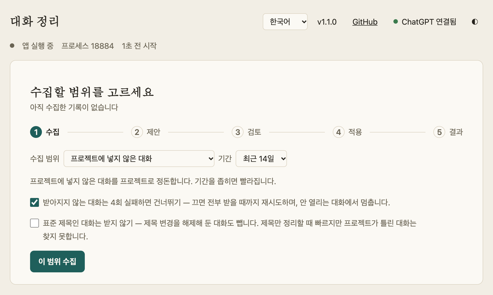
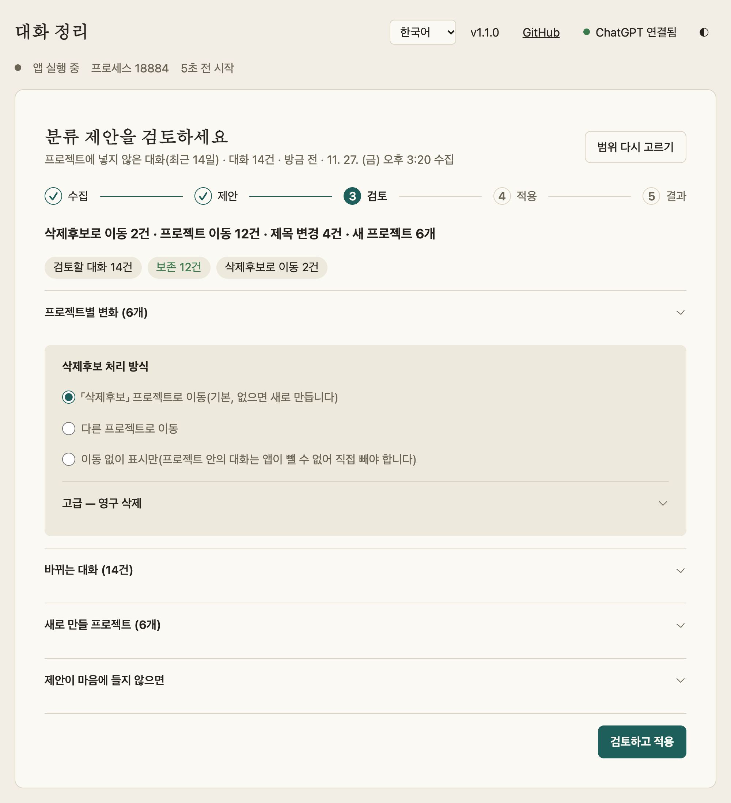

# ChatGPT 대화 정리

ChatGPT 대화의 제목을 정돈하고 관련 대화를 프로젝트로 모으는 로컬 앱입니다. Codex나 Claude Code가 제목·프로젝트 이동·삭제후보를 제안하고, 사용자가 화면에서 적용할 변경을 고릅니다. 삭제후보는 기본적으로 별도 프로젝트에 모읍니다.

화면 예시는 모의 데이터를 사용했습니다.

## 빠른 시작

### 에이전트에게 설치 요청하기

macOS 또는 Windows에서 Node.js 24 이상과 ChatGPT에 로그인할 브라우저가 필요합니다. Codex나 Claude Code에 아래 요청문을 보냅니다.

**한국어**

> https://github.com/yimsemin/chatgpt-conversation-maintenance 저장소를 내 컴퓨터에 내려받고 실행할 수 있게 준비해줘. AGENTS.md를 읽고 Node.js 버전과 설치 상태를 확인해. 준비가 끝나면 프로젝트 폴더 위치와 내가 직접 할 다음 단계만 한국어로 알려줘.

**English setup**

> Download https://github.com/yimsemin/chatgpt-conversation-maintenance to my computer and get it ready to run. Read AGENTS.md and check that Node.js 24 or later is available. Then tell me where the folder is and walk me through my first cleanup in English, using the app’s English labels.

### 첫 정리하기

1. **앱 켜기.** 설치한 폴더에서 macOS는 `start-local.command`, Windows는 `start-local.cmd`를 더블클릭합니다. 터미널 창을 닫으면 앱이 꺼집니다.
2. **ChatGPT 연결하기.** 처음 실행하면 브라우저에 연결 안내가 열립니다. 안내에 따라 **ChatGPT → 대화 정리** 버튼을 브라우저의 북마크바에 끌어다 놓고, `chatgpt.com`에 로그인한 탭에서 그 북마크를 누릅니다. 수집과 적용 중에는 ChatGPT 탭과 새로 열린 정리 창을 닫거나 최소화하지 않습니다.
3. **수집하기.** 처음에는 **프로젝트에 넣지 않은 대화**에서 **최근 14일**을 고르고 **이 범위 수집**을 누릅니다. **모든 대화**에는 보관된 대화도 포함되며, 대화가 많으면 오래 걸릴 수 있습니다. [수집 범위와 옵션](docs/ARCHITECTURE.md#수집-범위와-옵션)
4. **제안 받기.** 수집이 끝나면 **요청문 복사**를 누르고, 설치한 폴더를 연 Codex나 Claude Code에 붙여넣습니다. 에이전트가 제안을 만들면 앱에 검토 화면이 열립니다.
5. **검토하고 적용하기.** 제목과 이동할 프로젝트, 삭제후보를 확인하고 필요한 항목을 고칩니다. **검토하고 적용**을 누른 뒤 확인 창에서 **적용 시작**을 눌러야 ChatGPT에 변경이 반영됩니다.

앱에서 오류가 나면 **오류 복사**로 내용을 복사해 에이전트에게 전달합니다.

## 주의사항

- 앱은 비공식 ChatGPT 웹 API를 사용합니다. ChatGPT가 웹 서비스를 바꾸면 연결이나 정리 기능이 작동하지 않을 수 있습니다.
- 수집한 대화 사본은 기본적으로 설치 폴더의 `data/`에 저장됩니다. 분류에 사용하는 AI 서비스는 대화 발췌본을 처리합니다. [데이터와 로컬 설정](docs/ARCHITECTURE.md#데이터와-코드의-분리)
- 옮겨 둔 대화는 **삭제후보 확인**에서 복원하거나 영구 삭제할 수 있습니다. 영구 삭제는 되돌릴 수 없습니다. 대화 보관·보관 해제와 Memory 설정은 ChatGPT에서 직접 관리합니다.

## 라이선스

[MIT License](LICENSE)
